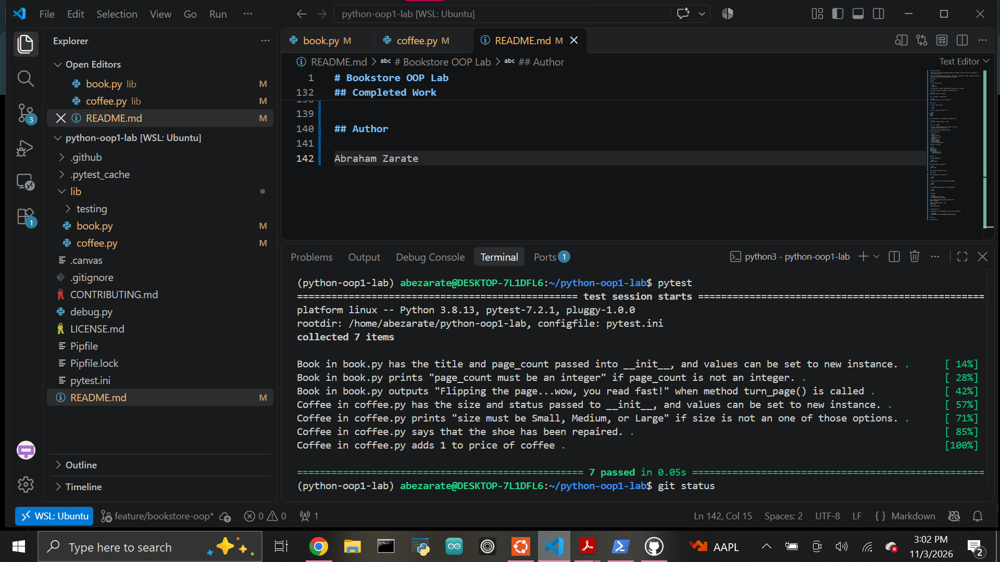

# Bookstore OOP Lab

A Python object-oriented programming project that models two objects found in a bookstore: a `Book` and a `Coffee`.

The project demonstrates Python classes, constructors, properties, setters, methods, attribute validation, and test-driven development with pytest.

## Features

### Book

A `Book` object stores:

- `title`
- `page_count`

The `page_count` property validates that the value is an integer.

If an invalid value is assigned, the program prints:

```text
page_count must be an integer
```

The `turn_page()` method prints:

```text
Flipping the page...wow, you read fast!
```

### Coffee

A `Coffee` object stores:

- `size`
- `price`

The `size` property accepts only:

```text
Small
Medium
Large
```

If an invalid size is assigned, the program prints:

```text
size must be Small, Medium, or Large
```

The `tip()` method:

- Prints a message thanking the customer for the tip.
- Increases the coffee price by `1`.

## Object-Oriented Programming Concepts

This lab practices:

- Classes
- Object instances
- `__init__`
- Instance attributes
- Properties
- Property setters
- Input validation
- Instance methods
- Test-driven development

## Project Structure

```text
lib/
├── book.py
├── coffee.py
└── testing/
    ├── book_test.py
    └── coffee_test.py
```

## Setup

Install dependencies:

```bash
pipenv install
```

Enter the virtual environment:

```bash
pipenv shell
```

This project uses Python 3.8.13.

## Testing

Run the complete test suite with:

```bash
pytest
```

Or stop at the first failure during development:

```bash
pytest -x
```

The completed project passes all provided tests:

```text
7 passed
```

## Example

```python
from lib.book import Book
from lib.coffee import Coffee

book = Book("The World According to Garp", 69)
book.turn_page()

coffee = Coffee("Large", 3.50)
coffee.tip()

print(coffee.price)
```

## Completed Work

A screenshot of the completed test suite can be added here:

```markdown

```

## Author

Abraham Zarate